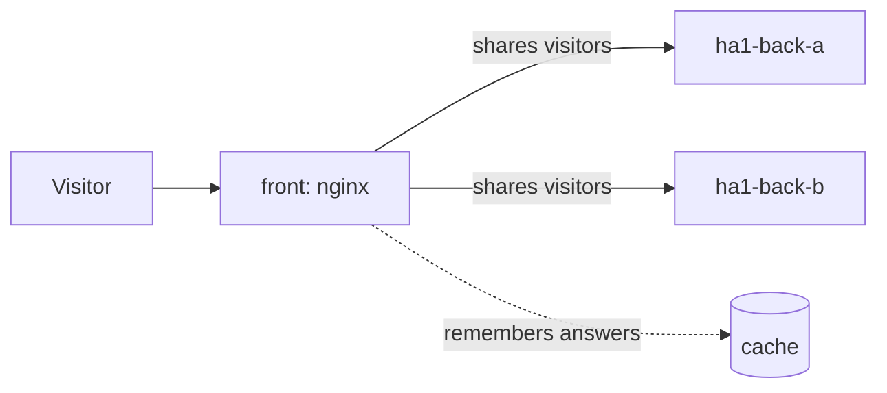

# Example 1: a website that survives a server dying (nginx only)

## The story

A shop's website runs on one computer. That computer breaks, and the shop is closed until someone fixes it. Customers go elsewhere.

The fix: run the site on **two** computers and put a "front door" in front of them. The front door sends each visitor to a server that works. If one server dies, nobody notices.

## How it works



One nginx (`front`) does three jobs:

1. **Load balancing:** visitors take turns between the two back servers.
2. **Caching:** a good answer is remembered for 10 seconds, so the back servers do less work. This is a small version of what a CDN does.
3. **Failover:** if a back server does not answer, nginx quietly asks the other one and stops using the broken one for 5 seconds before trying it again.

If *both* back servers are gone, nginx shows a friendly page instead of an error.

## Try it (teachers)

```bash
bash scripts/make-teacher-password.sh teacher   # once
cd examples/01-ha-nginx
podman compose up -d
```

- Students open the live page `http://<server>:9001` and the site `http://<server>:8001`.
- Teachers open `http://<server>:9001/teacher/` and log in. Press **Stop** on `ha1-back-a`. Refresh the site: it still works, and the answers now say `ha1-back-b`.
- Press **Stop** on both. The friendly page appears. Press **Start** and the site comes back by itself.
- Look at the response header `X-Cache-Status` of the site: `MISS` the first time, `HIT` on the next requests.

## The code

| File | What it does |
|---|---|
| `compose.yaml` | Starts all containers: front, two back servers, the status service and the gateway. |
| `nginx.conf` | The front door's rules. Every line is commented. |
| `down.html` | The friendly page shown when both back servers are gone. |
| `../../shared/backend` | The tiny website used as a back server. |
| `../../shared/status-service` | Feeds the live page and runs the Stop/Start buttons. |
| `../../shared/gateway` | Keeps the buttons behind a teacher password. |

Ports: site `8001`, live page `9001`.

## Limits worth knowing

- nginx looks up the back servers' names when it starts. If it starts while a back server does not exist at all, it refuses to start. Stopping a server (as in the demo) is fine.
- Only one front door exists here. If *it* dies, the site is down. Real sites add another layer above, or use several front doors; that is a topic for later.
- The second version of this example (`../02-ha-haproxy-varnish`) builds the same thing with the tools big sites use, and ends with a comparison.
