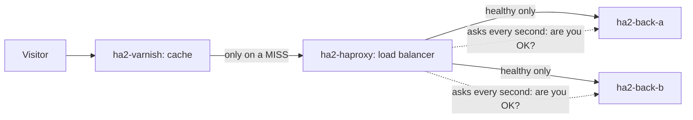

# Example 2: the same website, built the way big sites do it (HAProxy + Varnish)

## The story

Example 1 showed that two servers plus a front door keep a site alive. Big sites need the front door to be very good at two different things: **remembering answers fast** (so most visitors never touch a back server) and **sharing the rest of the visitors only with servers that are really healthy**. Instead of one tool doing both, they use one tool for each job.

## How it works



- **Varnish** is a cache. If it has a fresh answer (10 seconds), it replies at once. Otherwise it asks HAProxy.
- **HAProxy** asks each back server `GET /health` **every second**. A server that fails is removed straight away, even before any visitor is affected. When it answers twice in a row again, it is added back.
- If both back servers are gone, HAProxy replies with the friendly page in `down.http`.

## Try it (teachers)

```bash
bash scripts/make-teacher-password.sh teacher   # once, skip if you already did it
cd examples/02-ha-haproxy-varnish
podman compose up -d
```

- Site: `http://<server>:8002`. Live page: `http://<server>:9002`. Teacher buttons: `http://<server>:9002/teacher/`.
- HAProxy's own statistics page: `http://<server>:8402`. Stop a back server and watch its row turn red.
- The response header `X-Cache` is `MISS` the first time and `HIT` afterwards.

## The code

| File | What it does |
|---|---|
| `compose.yaml` | Starts Varnish, HAProxy, two back servers, the status service and the gateway. |
| `default.vcl` | Varnish's rules: cache for 10 seconds, show HIT or MISS. |
| `haproxy.cfg` | HAProxy's rules: take turns, check health every second, friendly error page. |
| `down.http` | The page shown when both back servers are gone. |

Ports: site `8002`, live page `9002`, HAProxy statistics `8402`.

## Example 1 or example 2?

| | 01: nginx only | 02: Varnish + HAProxy |
|---|---|---|
| Tools to learn | 1 | 2 |
| Config to read | one file | two files |
| Notices a dead server | when a visitor's request fails, then avoids it for 5 s | within 1 s, by asking, before any visitor is hurt |
| Cache | simple | built for speed, with its own language (VCL) |
| Statistics page | none | yes, in HAProxy |
| Best for | small sites, learning the idea | busy sites, when each part needs to be good at its job |

## Limits worth knowing

- Cached pages keep being served for a few seconds even after every back server is gone. That is by design (it is what a CDN does in an outage), but it can surprise you in a demo: use a page nobody has opened yet to see the error page.
- HAProxy looks up the back servers' names when it starts.
