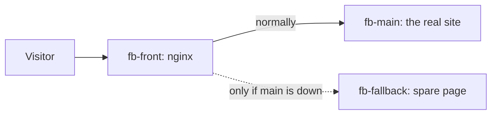

# Example 3: a "we're down" page that appears by itself

## The story

Sooner or later a website's server breaks or is being updated. Without preparation, visitors see a browser error that looks like the site no longer exists. With a **fallback**, they see a friendly notice, and the right status code tells search engines "come back later".

## How it works



In `nginx.conf` the real server is a normal `upstream` member and the spare is marked `backup`. nginx uses a `backup` server only when no normal server is available. When the main server comes back, nginx notices within a few seconds and visitors get the real site again.

The spare page answers with status **503** on purpose. A 503 says "temporarily unavailable"; a 200 would tell search engines that the notice *is* the page.

## Try it (teachers)

```bash
bash scripts/make-teacher-password.sh teacher   # once, skip if you already did it
cd examples/03-fallback
podman compose up -d
```

- Site: `http://<server>:8003`. Live page: `http://<server>:9003`. Teacher buttons: `http://<server>:9003/teacher/`.
- **Stop** `fb-main`, refresh the site: the maintenance page. **Start** it: the real site returns.

## The code

| File | What it does |
|---|---|
| `compose.yaml` | Starts the front door, the main site, the spare server, the status service and the gateway. |
| `nginx.conf` | The front door: main server first, `backup` spare second. |
| `fallback/` | The spare server's config and its page. |

Ports: site `8003`, live page `9003`.

## Compared with example 1

Example 1 has two *equal* servers sharing the work. Here one server does everything and the second only exists to say sorry. Use this when you cannot afford (or do not need) two real copies of the site, but still want a decent failure.
