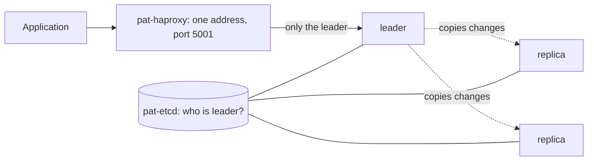

# Example 4: a database that elects a new leader when one dies (Patroni)

## The story

A database holds the shop's orders. If its one computer dies, the shop cannot take orders, and if the disk is lost, the orders are gone too.

The fix: keep **three copies**. One is the **leader** and accepts changes; the others are **replicas** that copy everything the leader does. If the leader dies, a replica is promoted and takes over. Nothing was lost, because the replica already had the data.

The hard part is deciding **who is the leader**. If two computers both believe they are the leader, they accept different changes and the data splits in two (a "split brain"). That is much worse than a short outage.

## How it works



- **PostgreSQL** is the database. There are three, `pat-pg1`, `pat-pg2`, `pat-pg3`.
- **Patroni** runs next to each PostgreSQL. It keeps PostgreSQL running as leader or replica and talks to etcd.
- **etcd** is the referee. The leader must keep renewing a short "lease" (15 seconds) in etcd. If it stops, the lease expires and the replicas race to take it; etcd lets exactly one win. This is how split brain is prevented.
- **HAProxy** gives applications one address. It asks every node `GET /primary`; only the leader says yes, so applications always reach the leader without knowing which node it is.

## Try it (teachers)

```bash
bash scripts/make-teacher-password.sh teacher   # once, skip if you already did it
cd examples/04-db-patroni
podman compose up -d --build                    # first start takes about a minute
```

- Live page: `http://<server>:9004`. Teacher buttons: `http://<server>:9004/teacher/`. Database address for applications: `<server>:5001` (demo login `postgres` / `postgres`).
- **Stop the leader.** After about 15–20 seconds another node becomes leader. Connections through port 5001 work again. **Start** the old one: it comes back as a replica.
- **Stop two database nodes.** The last one becomes leader on its own: no majority of database nodes is needed, only etcd.
- **Stop `pat-etcd`.** The live page shows "No leader". The leader steps down to read-only, because without the referee it cannot prove it is still the only leader. Start etcd again and a leader returns. Safety was chosen over availability, deliberately.

## The code

| File | What it does |
|---|---|
| `compose.yaml` | Starts etcd, three database nodes, HAProxy, the status service and the gateway. |
| `Containerfile` | Builds the database image: PostgreSQL plus Patroni. |
| `patroni.yml` | Patroni's settings, shared by all three nodes, every option commented. |
| `haproxy.cfg` | Routes port 5432 to whichever node is the leader. |

Ports: database `5001`, live page `9004`.

## Limits worth knowing

- etcd is a single copy here to keep the example small. In a real setup it is also three copies, otherwise etcd becomes the one thing that can kill the cluster, which the last demo step shows.
- The passwords are demo values written in the files. Never reuse them.
- Data lives inside the containers and is lost with `podman compose down -v`/removal.
